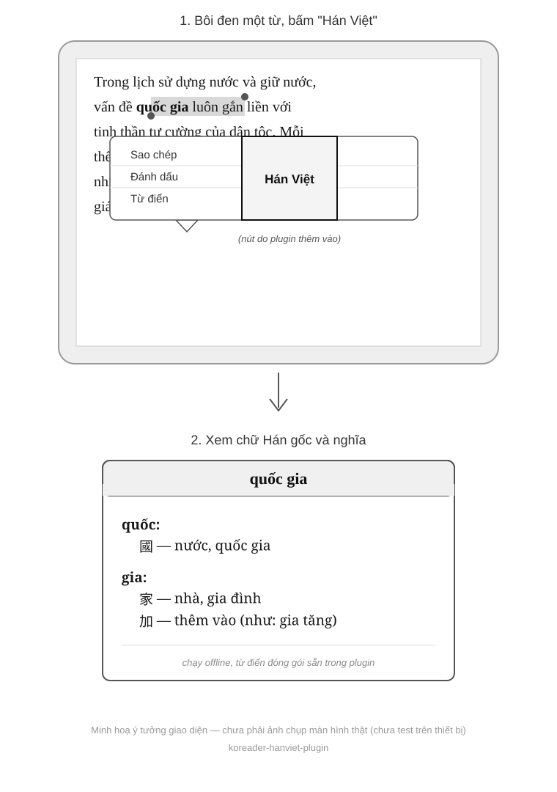

# koreader-hanviet-plugin

Plugin [KOReader](https://koreader.rocks/) hiện nghĩa Hán Việt (chữ Hán gốc +
nghĩa tiếng Việt) khi bạn chọn một từ hoặc cụm từ trong sách — chạy hoàn
toàn offline, dùng từ điển nhỏ đóng gói sẵn trong plugin.

Làm trên Kindle đã jailbreak chạy KOReader (test trên Kindle 11th gen, 2022).

*Đây là hình minh hoạ ý tưởng giao diện do mình tự vẽ, chưa phải ảnh chụp màn
hình thật — xem mục "Trạng thái / việc cần làm tiếp" bên dưới.*

## Cách hoạt động

Chọn (bôi đen) một từ hoặc cụm từ tiếng Việt như bình thường → menu popup
hiện thêm nút **"Hán Việt"** → bấm vào sẽ hiện chữ Hán gốc + nghĩa cho từng
âm tiết trong lựa chọn đó.

Một âm tiết Hán Việt có thể ứng với nhiều chữ Hán khác nghĩa (từ đồng âm
khác nghĩa) — ví dụ "tử" = 子 "con" hoặc 死 "chết" — nên plugin liệt kê hết
các khả năng tìm được thay vì đoán một nghĩa duy nhất.

## Cài đặt

1. Copy cả thư mục `hanviet.koplugin/` vào thư mục `koreader/plugins/` trên
   Kindle (qua USB, hoặc qua kết nối mạng tùy cách bạn đưa file lên máy).
2. Khởi động lại KOReader.
3. Mở một cuốn sách, bôi đen thử một từ (ví dụ "quốc gia") để kiểm tra nút
   "Hán Việt" đã xuất hiện trong menu popup chưa.

## Dữ liệu từ điển

`hanviet.koplugin/data/hanviet_dict.lua` là một bộ dữ liệu khởi đầu (~80 âm
tiết Hán Việt thông dụng), viết từ kiến thức ngôn ngữ phổ thông (loại kiến
thức dạy trong bài "từ Hán Việt" ở trường), **không** sao chép nguyên văn từ
một cuốn từ điển có bản quyền cụ thể nào.

Vì vậy bộ này còn rất nhỏ. Muốn mở rộng, xem hướng dẫn và quy ước ngay trong
comment đầu file `hanviet_dict.lua`. Vài nguồn dữ liệu mở có thể tham khảo
(tự kiểm tra license trước khi gộp vào):

- [Nôm Na Việt](https://github.com/nomnaviet) — từ điển Hán Nôm mở, dữ liệu
  JSON/CSV phẳng, hơn 45.000 từ ghép.
- [chinese-hanviet-cognates](https://github.com/topics/hanviet) — dữ liệu từ
  mượn Hán-Việt kèm tần suất.

## Trạng thái / việc cần làm tiếp

Đây là bản đầu tiên, **chưa test trên thiết bị thật**. Phần mình đã tự kiểm
tra được (chạy bằng `lua5.1` ngoài KOReader, mock lại các module của
KOReader):

- Cú pháp cả 3 file Lua hợp lệ.
- Logic tra từ (`lookupPhrase`): chuẩn hoá chữ hoa/thường, khoảng trắng,
  tra từ ghép nguyên cụm, tra từng âm tiết, xử lý từ đồng âm khác nghĩa,
  xử lý từ không có trong từ điển, không bị crash khi chọn rỗng.

Phần **chưa** kiểm chứng được vì cần chạy trong KOReader thật:

- `self.ui.highlight:addToHighlightDialog(...)` — đây là API cộng đồng hay
  dùng cho các plugin kiểu dịch/tra từ (dựa theo cách kotranslate.koplugin
  và các plugin tương tự làm), nhưng chữ ký chính xác có thể lệch đôi chút
  tuỳ phiên bản KOReader.
- `require("data/hanviet_dict")` — giả định KOReader thêm thư mục gốc của
  plugin vào đường dẫn require, theo quy ước các plugin nhiều file khác
  (ví dụ exporter.koplugin).

### Debug nếu nút "Hán Việt" không hiện ra

Mở `koreader/crash.log` (hoặc bật debug log trong Settings) sau khi mở
sách — nếu thấy dòng cảnh báo `hanviet: self.ui.highlight not available`,
nghĩa là cần đổi cách hook khác (báo lại để sửa tiếp).

## License

MIT — xem [LICENSE](LICENSE).
